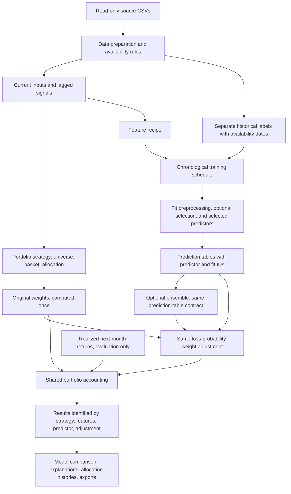

# Proposed next stage: explainable strategies, shared data, interchangeable predictors

Status update: strategy explanations, shared data preparation, explicit input
recipes, model configuration, case identities, and the four fixed-model
comparison are now implemented. See [the implementation and results](04_data_and_model_comparison.md).
The original design below is retained as the rationale. Persistent saved-run
loading, a SQLite catalog, Parquet artifacts, a frozen-at-origin policy and the
draft Quarto/notebook build are now implemented; see [current state](../docs/PROJECT_STATE.md).
Automatic selection/search, tuning, engineered recipes and cross-model ensembles
remain later stages.

## The question this design supports

Hold a portfolio strategy and its ML allocation rule fixed. Change the model
that predicts a stock's next-month loss probability. Compare each resulting
portfolio with its original strategy over exactly the same months.

Later, change the feature recipe, feature selection, or predictor composition
without rewriting the portfolio strategy or portfolio accounting.

An experiment is a combination of:

```text
data + evaluation schedule + feature recipe + predictor
     + portfolio strategy + prediction-to-weight adjustment
```

“ML strategy” can otherwise mean several things. The UI should name the specific
portfolio, model, features, and adjustment separately.

## What exists and what needs to change

We already have strict CSV validation, lagged return signals, a shared portfolio
engine, strategy functions, model timing audits, and experiment exports. Reuse
these foundations.

The main limits are that data preparation lives inside `ExperimentRunner.run`,
`predict_losses` constructs logistic regression directly, the feature check only
allows original columns, and result/UI keys assume `baseline` versus one
`loss_adjusted` version. The current strategy descriptions also omit differences
in basket selection, weighting, and fallback behavior.

## Proposed flow



## 1. Make the strategies understandable

Use the [strategy guide](01_strategy_guide.md) as the explanation reference.
Extend each `StrategySpec` with structured explanation fields:

```text
plain-language name and purpose
permitted universe and fitted-screen policy
monthly stock-selection rule
weighting rule
lookback windows and required inputs
fallback behavior
ML adjustment explanation and one numerical example
```

Show these in a Strategy guide tab and an expandable explanation beside the
allocation strategy selector. Read from one metadata definition so the UI and
exported explanation agree. Expose the actual configured windows and fractions,
rather than duplicating hard-coded prose. Keep stable code IDs for saved runs;
improve display names without breaking previous references.

## 2. Extract a small data pipeline

Add `research/data.py` to prepare and validate data once per run. Existing source
files stay in place. Use functions and a small `PreparedData` container, without
introducing a database, workflow service, or new storage framework.

Separate these data products:

| Product | Contents and contract |
| --- | --- |
| Current inputs | Stock-month keys and features available at the decision snapshot. No forward target. |
| Realized return history | Returns mapped from their source rows to the months they were earned. |
| Historical labels | Keys, target, earned month, and assumed availability date; training accesses only known labels. |
| Strategy signals | Lagged momentum and risk, history counts, eligibility, and signal provenance. |
| Evaluation schedule | Decision dates, earned-return dates, fit dates, and the fixed screen origin. Shared by every compared case. |

The preparation layer exposes a current snapshot and a training slice as of a
specified decision date. A training slice must satisfy
`label_available_at <= fit_snapshot`. Under the existing course convention,
the label on row t becomes available at t+1 month-end. Longer-horizon labels
would need their own availability/overlap rules.

Missing calendar months must break a rolling history; never fill missing returns
with zero. Zero allocation for an unheld stock is a different operation. The
default validation mode must not open the test file.

Record hashes, calendar coverage, source schema, feature definitions, units,
history requirements, exclusions, and missingness. Add a compact Data overview
in the app so a user can see which data and dates a run actually uses.

## 3. Give features an explicit place before searching them

Add a `FeatureSpec`: a named recipe containing input columns, deterministic
derived features, and optional learned selection. The first recipe is the
existing twenty factors, with no selection. Later recipes can add lagged
momentum/risk, explicit composites, or a chosen original-feature subset.

Distinguish three operations:

- A deterministic lagged feature uses only history available at the snapshot.
- A manually declared column list selects inputs without fitting anything.
- A learned scaler, PCA, selector, or imputer must be fitted inside the model's
  historical training folds and applied to later data using that fitted state.

Use an sklearn `Pipeline` for learned preprocessing, selection, and estimator.
The preprocessing can differ by model; all compared models still receive the
same declared candidate inputs and evaluation rows. Record the actual selected
columns per fit, since a learned selector may choose different columns over time.

Choose any missing-history policy explicitly and keep the evaluation universe
matched across cases, rather than silently dropping different stocks per model.
Do not infer that engineered composites bypass the assignment's feature limit;
retain input lineage and account for the final subset of at most ten features.

References: [sklearn Pipeline](https://scikit-learn.org/stable/modules/compose.html#pipeline-chaining-estimators)
and [leakage guidance](https://scikit-learn.org/stable/common_pitfalls.html#data-leakage).

## 4. Replace the fixed classifier with a predictor registry

A `PredictorSpec` supplies a name, estimator factory, preprocessing, fixed
parameters, random seed, and later tuning/calibration specifications. The
training scheduler handles date boundaries; individual models do not choose
their own train/test dates.

Proposed first comparison: logistic regression, Gaussian naive Bayes, random
forest, and histogram gradient boosting. Retain a historical loss-frequency
control, which does not count toward the four model types. Start with fixed
settings and the existing twenty-factor recipe to isolate the model change.
Search ranges for at least two tunable models can be added in the following
training-only tuning experiment, as required by the assignment.

All initial predictors estimate the same event: `R1M_Usd < 0` over the next
month. They train on the same historical stock-month examples, share an annual
expanding refit schedule, and produce one table per prediction configuration:

```text
prediction_id | predictor_id | feature_spec_id | date | stock_id
probability_of_loss | fit_id | fit_snapshot | trained_through_return_month
```

Probabilities must be finite and in [0, 1]. Missing predictions are an explicit
failure/policy decision, not a silent zero-loss forecast. Record model failures
and one-class fallbacks. Check calibration as well as ranking metrics; a shared
probability-to-weight formula does not make models' probabilities equally reliable.

Train each predictor once per feature recipe and scheduled fit, then reuse its
predictions across all selected portfolios. Compute each original portfolio
once. With eleven strategies and four models, the run contains **11 originals
plus 44 adjusted portfolios**, not four repeated copies of each original.

Keep adjustment strength fixed during the first model comparison. A later
experiment can vary the adjustment separately. Classification quality and
portfolio performance are separate evaluations.

## 5. Use experiment identities that survive more models

Introduce an `ExperimentSpec` collecting the data/evaluation specification,
strategy IDs, feature recipe IDs, predictor IDs, and adjustment specification.
Prefer small configuration objects and registries of functions over a deep
inheritance hierarchy.

Replace semantic string parsing of `strategy::loss_adjusted` with a case table:

```text
case_id | strategy_id | predictor_id | feature_spec_id | adjustment_id
```

An original case has no predictor or feature recipe and uses identity
adjustment. Every weights/returns/metrics/diagnostics table carries its case ID.
Readable labels come from metadata, not from splitting a string.

Cache predictions using data and recipe/code hashes, task, training cutoff,
schedule, preprocessing/selection settings, model parameters, and seed. Cache
baseline weights separately. A change in model must not change a baseline.
The UI must identify cached results from an older configuration as such.

The app should offer Strategies, Models, Feature recipe, and Evaluation controls,
with a run-size preview. For one strategy, compare original plus one version
per selected model. Allow wider comparisons explicitly; do not turn every
available feature/model/strategy combination into an automatic large search.

## 6. Leave an ensemble interface for the following stage

An ensemble implements the same prediction-table output as a single predictor.
It specifies member prediction configurations and a combination rule. The
portfolio strategy and weight adjustment do not need to know how the final
probability was produced.

First ensemble to implement later: a fixed equal average of aligned member
probabilities. Members must predict the same event and horizon with matching
stock-month keys and valid fit cutoffs. Record members and weights. A missing
member must not silently alter the mixture. Reject circular dependencies.

Later, learn mixture weights or stack models using chronological out-of-sample
predictions generated within historical training data. Do not train an ensemble
on base models' in-sample predictions or on the final evaluation outcomes.
Implement chronological prediction generation explicitly; default classifier
cross-validation/stacking settings are not a time-aware stock-panel protocol.

Averaging model probabilities before one allocation is a prediction ensemble.
Averaging already-constructed portfolio weights is a separate portfolio rule;
the two can produce different results and should have distinct configurations.

References: [sklearn voting and ensembles](https://scikit-learn.org/stable/modules/ensemble.html#voting-classifier)
and [stacking estimator documentation](https://scikit-learn.org/stable/modules/generated/sklearn.ensemble.StackingClassifier.html).

## Validation and completion criteria

All stocks in a month stay together. Any tuning uses `GridSearchCV` with explicit
chronological month-group splits inside the historical training slice. Avoid
random row splits and fitting a selector before cross-validation. Model choice,
feature choice, ensemble weights, and adjustment strength are decisions made
using training-period validation, not the already-viewed test results.

Scheduled refits may use earlier evaluation returns once realized, under the
declared expanding policy. They must never see later evaluation outcomes.
All compared cases share this policy and the same evaluation calendar.

Acceptance checks for the implementation stages:

- The migrated logistic model reproduces current predictions and portfolio results.
- All eleven original baselines match their saved results and appear only once.
- Future-label and future-feature perturbations cannot alter earlier predictions,
  fitted transforms, screens, or weights.
- Changing a model leaves the shared data schedule and original allocations fixed.
- Changing feature selection fits it only on the permitted historical rows and
  records the chosen columns for each fit.
- Every predictor can feed the same allocation adjustment without strategy edits.
- Cached outputs cannot be reused under incompatible data/model/feature settings.
- UI explanations and result labels identify the actual case being displayed.
- A later ensemble can consume aligned base predictions and pass through the
  same accounting and charts without special portfolio code.

## Suggested implementation sequence

1. **Explain:** add structured strategy explanations and the in-app guide.
2. **Prepare data:** extract the current behavior into a tested preparation layer;
   preserve current calendars, screens, predictions, and baseline results.
3. **Compare models:** add predictor/feature configuration and case identities;
   reproduce logistic regression, then run the four fixed model types with the
   same feature recipe and loss-weight adjustment.
4. **Study features and tuning:** compare declared recipes/subsets and learned
   selectors through chronological training-only pipelines; add `GridSearchCV`.
5. **Combine predictors:** implement the ensemble interface and fixed probability
   averaging first; consider learned combinations only after the timing checks.

This sequence makes the next review a comparison of models with the trading
rule held fixed. It reserves feature search and ensemble experiments for
separate, identifiable stages.
