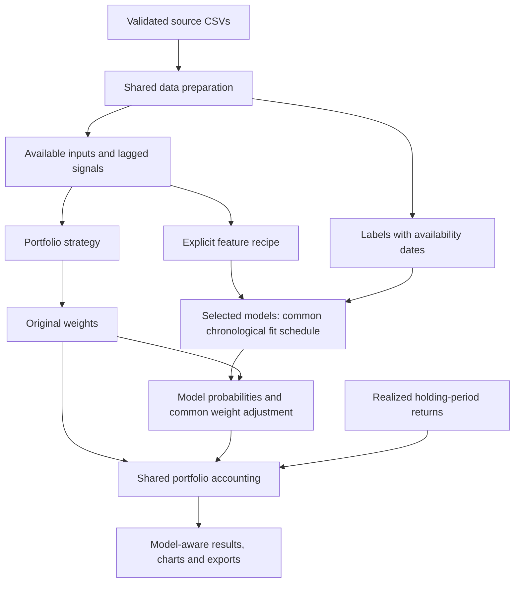

# Shared data pipeline and fixed-model comparison

The four requested implementation steps are complete: in-app strategy
explanations, shared data preparation and date handling, model/feature
configuration with exact logistic parity, and a fixed four-model comparison.

## What changed

Each strategy now has structured explanations of its purpose, permitted pool,
monthly selection, weighting, required history, fallback and a small example.
The same metadata appears in the app's Strategy guide, the Allocations view,
and exported manifests. The guide is also available before running an experiment.

`research/data.py` prepares inputs once per run. Source validation, forward-return
mapping, evaluation dates, lagged signals and frozen screens are shared. Model
inputs and labels are separate tables. A training slice joins only labels whose
availability date is no later than the fit snapshot.

`FeatureSpec` declares all twenty original factors or an explicit original-factor
subset, with a stable identity, input order and lineage. All compared models use
that same recipe and evaluation rows. A model's preprocessing is fitted within
its own historical training window. Automatic feature selection is not performed;
the sklearn pipeline includes a named insertion point for a later selector.

`ModelSpec` supplies an estimator factory and fixed preprocessing. The common
training scheduler performs expanding fits every twelve decision months. Each
model generates one probability table, reused across the thirteen portfolios.
The same loss-probability adjustment and strength are applied to every model.

Results have an explicit case table identifying strategy, model, feature recipe,
and adjustment. UI charts and inspectors use that metadata rather than parsing
variant strings. The original portfolio appears once per strategy. Model-specific
predictions, fit audits and calibration are separately exported.



## Exact reproduction before adding other models

Before refactoring, the current implementation was run and its predictions,
portfolio return series, keyed weights and source code saved independently.
After the refactor, comparison against that reference found:

- **71,631 logistic probabilities identical**, without numerical tolerance.
- **26 portfolio books identical:** thirteen originals and thirteen logistic-adjusted versions.
- **26 complete keyed weight histories identical.**

A permanent regression check also compares logistic probabilities against the
earlier saved experiment's CSV. The original eleven notebook baselines retain
their independent saved-result checks. Changing models or declaring a manual
feature subset does not alter original portfolio weights.

## Fixed models

| Model | Specification |
| --- | --- |
| Logistic regression | Training-fitted StandardScaler; C=1; lbfgs; max_iter=1000; seed 0. |
| Gaussian naive Bayes | GaussianNB; var_smoothing=1e-9; no scaling. |
| Random forest | 100 trees; maximum depth 6; minimum leaf 50; sqrt feature sampling; seed 0; one job. |
| Histogram gradient boosting | 100 iterations; learning rate .05; 15 leaves; minimum leaf 50; L2=1; seed 0; early_stopping=False. |

These settings are declared fixed, not selected by the evaluation results.
Models predict `R1M_Usd < 0` using all twenty original factors for this comparison.
One-class training samples have an explicit constant-probability fallback.
No hyperparameter search, calibration fit, learned feature selection, or
cross-model ensemble is performed. Random forest and boosting use ensembles of
trees internally; a later combination of distinct predictors is a separate stage.

Primary references: [sklearn pipelines](https://scikit-learn.org/1.4/modules/compose.html),
[GaussianNB](https://scikit-learn.org/1.4/modules/generated/sklearn.naive_bayes.GaussianNB.html),
[random forest](https://scikit-learn.org/1.4/modules/generated/sklearn.ensemble.RandomForestClassifier.html),
[histogram boosting](https://scikit-learn.org/1.4/modules/generated/sklearn.ensemble.HistGradientBoostingClassifier.html).

## Matched training-validation experiment

The first 60 training months supply initial history. Predictions and portfolio
returns cover **Jan 2005–Dec 2009**, with five scheduled annual expanding fits.
Frozen pools are selected using history known at Dec 2004. Each later refit may
use earlier validation outcomes once realized; it cannot use later outcomes.
This experiment never opens the test CSV.

There are **65 portfolio cases: 13 originals plus 52 adjusted portfolios**.
All share evaluation dates, source returns, feature recipe, and adjustment
strength 0.5. Portfolios remain long-only and fully invested; results are gross
of costs with zero reference returns for Sharpe and Sortino. Source outliers
are retained.

Predictive diagnostics, pooled across the 71,631 evaluation stock-month rows:

| Predictor | Brier score ↓ | Log loss ↓ | ROC AUC |
| --- | ---: | ---: | ---: |
| Historical loss-rate control | 0.249023 | 0.691215 | 0.494807 |
| Logistic regression | 0.249667 | 0.692578 | 0.500801 |
| Gaussian naive Bayes | 0.259759 | 0.714980 | 0.509354 |
| Random forest | 0.249387 | 0.692021 | 0.505785 |
| Histogram gradient boosting | 0.249715 | 0.692719 | 0.507280 |

No model beats the historical loss-rate control on Brier score or log loss.
ROC AUC alone does not establish reliable probabilities or a profitable
allocation rule. The control's score varies across annual fits, so its pooled
AUC need not equal exactly 0.5.

Illustrative portfolio CAGR comparisons; all 65 cases are in the saved report:

| Version | Equal-weight universe | Momentum score weights | Frozen high-volatility pool + momentum |
| --- | ---: | ---: | ---: |
| Original | 7.62% | −1.74% | 2.64% |
| Logistic regression | 7.57% | −1.74% | 2.79% |
| Gaussian naive Bayes | 7.51% | −1.53% | 3.38% |
| Random forest | 7.59% | −1.69% | 2.68% |
| Histogram gradient boosting | 7.58% | −1.70% | 2.56% |

Effects depend on the underlying portfolio. This initial comparison provides
no clear basis to adopt an ML adjustment. Feature and ensemble experiments can
now be compared through the same preparation, fitting and accounting boundaries.
The already-viewed 2010–2018 test period was not used for this model comparison.

## Review the result

Open the app, select models and a feature recipe, then Run comparison.
Model-specific curves appear alongside originals. Select all strategies to
show every selected rule across the three graphs. Allocation views can compare
several models over time; the rebalance inspector identifies which model's
probabilities and training dates are shown.

Saved outputs:

- [All portfolio metrics](outputs/fixed_models_validation/strategy_comparison.csv).
- [Changes from each original](outputs/fixed_models_validation/paired_changes.csv).
- [Predictive metrics](outputs/fixed_models_validation/model_metrics.csv).
- [Standalone interactive wealth/drawdown comparison](outputs/fixed_models_validation/wealth_drawdown_model_comparison.html).
- [Data audit](outputs/fixed_models_validation/data_audit.json).
- [Case identities](outputs/fixed_models_validation/cases.csv).
- [Parity and preservation checks](outputs/fixed_models_validation/verification.json).

Each model also has its own `models/<model_id>/predictions.csv`, `fits.csv`, and
`calibration.csv`. The manifest records inputs, source/code hashes, fixed
parameters, feature lineage, strategy explanations and accounting assumptions.

## Reproduce or extend

```bash
python3 -m research --all --all-models
python3 -m research --strategies momentum_weighted --ml --models logistic random_forest
python3 -m research --strategies momentum_weighted --ml --features Ocf_Toa Fcf_Yld
```

```python
from research import ExperimentRunner, FeatureSpec, RunConfig, default_model_registry

result = ExperimentRunner().run(RunConfig(
    strategies=("equal_weight_universe", "momentum_weighted"),
    include_ml=True,
    models=tuple(default_model_registry()),
    feature_spec=FeatureSpec(),
))
print(result.model_metrics)
print(result.paired)
```

A different manually declared subset is a different feature recipe. It is not
automatic selection or evidence that the subset is optimal. Later learned
selectors and tuning must fit inside chronological training folds. Later
cross-model ensembles must preserve the probability-table contract and use
historical out-of-sample predictions when learning combination weights.
