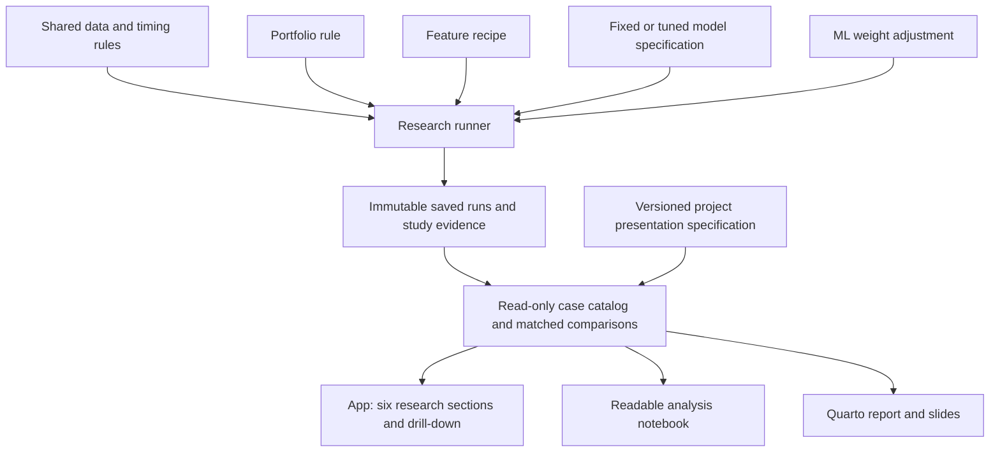

# One research story for the app, report and slides

**Navigation update:** [TAB_REFACTOR_HANDOFF.md](TAB_REFACTOR_HANDOFF.md) is the
authoritative latest plan. It uses five progressive tabs and reserves the third
for an advanced strategy the user has not defined. The candidate hybrid examples
below are historical suggestions; do not use them to fill that reserved tab.
This older document remains background for shared evidence and reporting.

## Scope and implementation status

The user's six goals below define the presentation and comparison requirements.
This document proposes the implementation sequence. The current runner, saved
experiments and first feature study remain working evidence; the shared
multi-run presentation layer described here has not yet been implemented.
No new fitting, tuning, strategy selection or submission release change was
performed for this design update.

## The six questions

| Section shared by app and report | Question and evidence | Current status |
| --- | --- | --- |
| 1. Regular strategies | What do equal weight, volatility, momentum and risk-adjusted pools do? Explain rules and compare return, risk, turnover and concentration. | Fourteen rules, explanations and saved results exist, including the cash-capable annual-consistency rule. |
| 2. A simple ML strategy | What changes when a loss-probability model adjusts a very simple portfolio? Start with equal weight plus the existing soft adjustment; compare with its original. | Predictions and paired portfolios exist; a dedicated teaching view is proposed. |
| 3. My hybrid strategy | What is the hypothesis behind the author's pool, momentum weighting and ML adjustment? Compare equal weight, the same hybrid without ML, and the hybrid with ML. | High-volatility, Sharpe, Sortino and annual-consistency/cash variants exist. The final featured hybrid is undecided. |
| 4. Feature selection | What changes with fewer inputs, and why were features kept or excluded? Show all twenty, ANOVA ten and correlation-pruned ten using the same model and trading rules. | First matched training-only study is saved and viewable. Improvements are small and mixed. |
| 5. Hyperparameter tuning | What was searched, how was it validated, and what improved versus fixed settings? Show fold scores, parameter choices, stability and runtime, plus portfolio effects. | Planned; no completed search evidence. |
| 6. Overall comparison | Which choices offer useful return/risk trade-offs, and which one is justified? Show an understandable overview with drill-down and a final recommendation. | Per-run and feature-study comparisons exist. A shared overview across stages is proposed. |

Sections 2 and 3 can use the same loss-probability model and adjustment rule.
Their different portfolio construction makes the comparison useful; it does not
constitute a new prediction algorithm. Describe the hybrid as an author-designed
combination and explain its rationale without claiming academic novelty.

For a first teaching example, use logistic regression plus equal weight. For the
hybrid, the Sortino pool or the newly implemented annual-consistency pool plus
positive-momentum/cash budgeting and optional ML haircut are candidates matching
the research questions. The cash rule is documented in
[its experiment guide](../0_4_Consistency_Momentum_Cash/README.md).
These are presentation proposals, not final selections based on performance.
Keep all four model types available for the assignment comparison.

## Shared design

Keep `research/runner.py`, the strategy registry, selectors, common accounting
and `research/store.py`. Add a small read-only layer above saved artifacts.
Extend the working feature-study pattern as tuning evidence becomes available.
Avoid a generic workflow engine or a UI framework migration for this stage.

### Explicit case references and experiment stages

A case is one portfolio result. A run contains several cases. A study links runs
for one controlled question. A presentation release selects evidence for the six
sections. These are different objects with different responsibilities.

Reference a saved case by `(run_id, case_id)`; case_id alone is not globally
unique across runs. Carry model identity/settings, feature recipe, adjustment,
evaluation protocol, date range and provenance into every comparison row.
Add tuning-study references when implemented; do not infer tuning from labels.

The presentation specification should name section IDs, titles, explanatory
text, selected case references, controlled comparison pairs, study references
and the final choice/status. It should select a manageable featured set while
leaving the full case catalog accessible. Human explanations can be shared;
numerical claims, tables and charts must come from saved evidence.

Evolve `submission/release.json` with a versioned schema that can pin multiple
runs/studies and resolve every selected case. Keep old single-run releases
loadable. Do not repin the current release as part of planning. A presentation
draft may show a pending tuning section with no fabricated results.

### Fair comparison rules

- Compare controlled changes on identical earned-return months, source data,
  accounting assumptions, eligible-universe rules and model-fitting policy.
  Intended strategy differences such as the selected basket are explicit.
- Partition training validation and official frozen test results into separate
  views. Never rank them together or silently shorten different date ranges.
- For ML impact, pair each adjusted portfolio with its own non-ML original.
  For feature impact, hold the model, parameters, trading rule and overlay fixed.
  For tuning impact, hold the feature recipe and trading rule fixed first.
- Label comparisons changing multiple components as combined changes; they
  cannot isolate the effect of feature selection or tuning.
- Deduplicate repeated original portfolios only after checking matching
  protocol and returns; keep all source references traceable.
- Existing feature studies require identical calculation code/runtime. Any new
  comparison across versions must explicitly justify numerical compatibility
  with verification evidence rather than relaxing that guard silently.
- Show probability quality separately from portfolio outcomes. Keep the
  historical loss-rate prediction control as well as non-ML portfolio controls.
- State the existing test inspection, gross returns, concentration, zero risk
  free/target rates and other dataset limits. Selection can help or hurt.

## Presentation design

Use the six sections as the app's main research navigation. Keep allocations,
data checks, model diagnostics and strategy definitions available as drill-down.
Keep experiment computation an explicit action outside routine result browsing.

The overall comparison should start with a compact table grouped by regular,
simple ML, custom hybrid, selected-feature and tuned versions. Display CAGR,
annualized volatility, Sharpe, Sortino, maximum drawdown, turnover and
concentration where recorded; load saved diagnostics on demand when necessary.
Offer a return-versus-risk plot and changes versus the appropriate parent.
Allow every comparable strategy to be selected, while defaulting line charts
to a small explanatory set. A single figure with every line is hard to read.

Use the same table definitions, selected cases, comparison pairs and chart data
in the app, notebook, report and slides. Interactive Plotly and static publication
figures may have separate rendering adapters; calculations and selection logic
belong in the shared read-only layer. Presentations may shorten explanations
without changing the underlying evidence.

For the approximately 15-minute deck, plan about one minute for the question and
data, two each for regular/simple-ML/custom-hybrid results, two each for feature
selection and tuning, and two for the final comparison and limitations. Put full
grids, detailed selection audits and extra strategy curves in an appendix.

## Tuning artifacts to retain

Record the declared parameter grid, scoring direction, month-group chronological
fold definitions and label-availability cutoffs. Save candidate parameters,
per-fold scores, means and dispersion, ranks, fit/score times, chosen parameters
and refit provenance for every outer origin. Store feature counts/masks for the
selected refits; if fold-level selection stability is claimed, collect those
masks explicitly because GridSearchCV's ordinary results do not provide them.

Selectors and scaling remain inside the searched pipeline. Use training-only
GridSearchCV for at least two tunable models. Compare selected tuned models with
fixed models using identical outer validation months; inner search scores alone
are not evidence of improvement on outer validation or portfolio performance.
Store full portfolios for selected specifications, with compact trial tables
for search candidates. Record actual compute cost and failures.

## Implementation order and acceptance evidence

1. **Shared comparison foundation.** Add a read-only cross-run case catalog,
   explicit parent/comparison references and protocol checks. Prove saved
   originals and predictions are unchanged, repeated baselines deduplicate
   correctly, incompatible periods are rejected, and browsing never fits.
2. **One presentation specification, three readers.** Add a versioned multi-run
   release and shared section/table/chart-data functions. Preserve old releases.
   Confirm the app, notebook and QMD/slide readers resolve the same cases and
   metrics. Build a draft with pending sections clearly identified.
3. **Reorganize the app and draft submission.** Expose the six sections, the
   simple paired example, a clearly labeled candidate hybrid, existing feature
   evidence and the overall comparison. Keep advanced diagnostics accessible.
4. **Run the small declared tuning study.** Add chronological GridSearchCV,
   retain the artifacts above, and populate its shared app/report section.
5. **Choose and publish.** Use training-period evidence to select the final
   hybrid/model/recipe. Run the frozen official test experiment, pin its evidence
   explicitly, finish the narrative, execute the readable notebook, and build
   QMD/HTML report and slides with model computation disabled.

These are staged implementation tasks. This design document does not claim
that the proposed cross-run catalog, release schema or tuning workflow exists.
