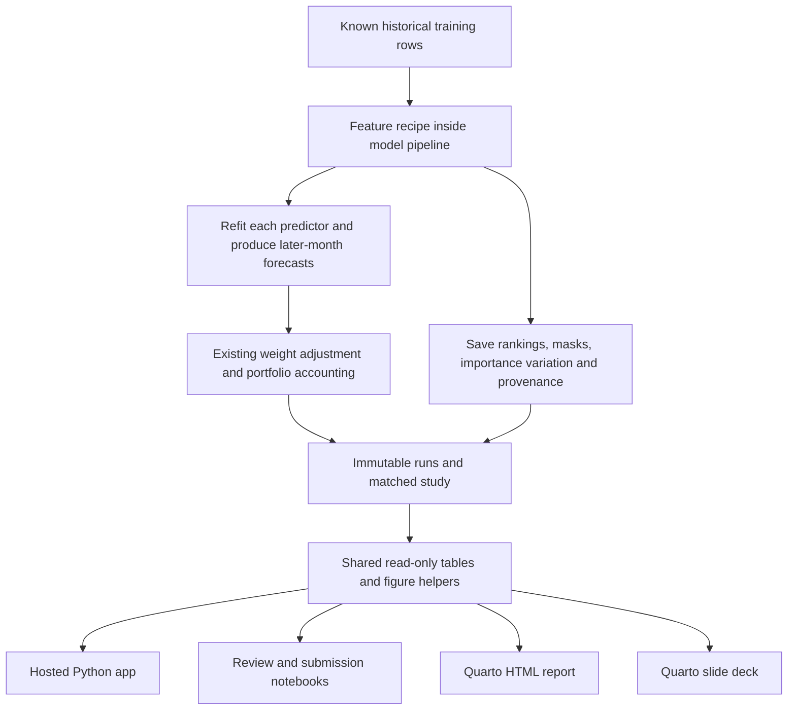

# Random-forest feature selection: implementation and presentation plan

Status: **implemented after the user's "Preform the plan"**, 2026-11-09.
Study `features_20261109T202318_8b01fe74` and all app/notebook/QMD/slide integrations
are complete. Read [findings](../0_3_Feature_Selection/05_random_forest_findings.md)
and [verification](verification/random_forest_20261109.json). The original plan
below records the protocol; its proposed work is no longer pending. There is
no declared winning feature set or official test evaluation. The release now
adds this study alongside its preserved main run. Separate tuning holdout work
is documented in TUNING.md and is not part of this fixed-model study.

## Proposed addition

Add **Random forest top 10** as a fourth feature recipe. A forest fitted on all
twenty candidate factors ranks them by their training impurity importance.
Retain the ten highest-ranked eligible factors, then independently fit each of
the four downstream classifiers on those inputs. A forest used to select
features and a forest used to predict next-month direction have separate roles.
Logistic regression, naive Bayes and boosting can also use forest-selected inputs.

The main visualization is a sorted horizontal importance chart for all twenty
factors, with selected factors highlighted and error bars showing variation
across the selector forest's trees. Pair it with the existing actual-input table
and selection-through-time chart. This extends the two existing feature subtabs.

## Source grounding

- Local textbook [chapter 29](../../p4dsf/chapters/29_student_loan_overfitting/student_loan_overfitting.ipynb),
  cells 59–62, introduces decision-tree `feature_importances_` and a ranked
  importance table. Cells 63–70 introduce and fit random forests. It supports
  the method's teaching context; those cells do not provide this exact forest
  selection chart or our chronological panel protocol.
- [Chapter 34](../../p4dsf/chapters/34_option_volume_feature_selection/option_volume_feature_selection.ipynb)
  includes a random-forest regression/backtest example. Its cross-validation
  example is not the month-forward, label-availability protocol required here.
- sklearn's [forest-importance example](https://scikit-learn.org/stable/auto_examples/ensemble/plot_forest_importances.html)
  is the direct reference for importance bars and standard deviation across
  trees. Use the local installed sklearn version and record it in provenance.
- sklearn's [permutation-importance guide](https://scikit-learn.org/stable/modules/permutation_importance.html)
  explains model dependence, predictive-quality checks and correlated-feature
  limitations. Permutation importance is a useful later diagnostic; it is not
  an additional selection recipe in the first implementation.

## Fixed comparison protocol

Write a new study plan before computation, using the existing runner and store:

| Item | Initial proposal |
| --- | --- |
| Recipes | All 20; ANOVA top 10; correlation-pruned up to 10; random forest top 10 |
| Prediction target/scope | Next-month loss, pooled across stocks |
| Predictors | Existing logistic, Gaussian naive Bayes, random forest, histogram gradient boosting |
| Training validation | Existing first-60-snapshot initial history; earned Jan 2005–Dec 2009 |
| Refit policy | Annual expanding fits using only labels available at each origin |
| Portfolio rules | All fourteen current non-ML originals and their fixed downside overlays |
| Cash momentum / adjustment | Explicitly fix three-month cash momentum and strength 0.50 across all recipes |
| Selector | 100 trees, depth 6, minimum leaf 50, `max_features="sqrt"`, seed 0, one job |
| Other selector settings | Gini criterion, bootstrap enabled, no class weighting; record full parameters |
| Search / final test | Neither is part of this study |

The proposed selector settings mirror the current pooled forest's fixed
regularization. They are a declared starting point, not optimized settings.
Keep selector configuration independent from downstream classifier settings.

Only the feature recipe changes within this study. Recompute all four recipes
under the same calculation version, with exact-compatible cache reuse where
available. The old three-recipe study stays readable and unchanged. Its older
code/configuration and thirteen-rule coverage cannot be silently combined with
a new forest-only run to claim a matched comparison.

Four recipes × fourteen rules × five versions (original plus four predictors)
gives 280 saved portfolio cases, including repeated unchanged reference books.
Forecasts are shared across strategies within a run, as today. Annual five-origin
fits give 80 downstream classifier fits; the simple pipeline implementation also
fits the forest selector twenty times (four predictors × five origins). Fixed
training rows/settings/seed must give the same forest mask across predictors at
each origin. Benchmark the first fit before the complete run and record actual
time/storage; no new cross-model caching engine is needed for this addition.

## Computation and audit changes

1. Extend `research/features.py::FeatureSpec` with a `random_forest` selection
   option and explicit, serializable selector settings. Put settings in feature
   identity/metadata and update `research/store.py::config_from_dict` to round-trip
   them. Historical configs must load with defaults; historical artifacts remain
   browsable even if calculation hashes no longer match current cache requests.
2. Extend the existing cloneable selector in `research/selection.py`. Keep it
   inside `ModelSpec.pipeline`, before scaling. It receives only the historical
   fitting rows and labels, including within each future tuning fold. Preserve
   existing ANOVA/pruning numerics. Keep estimator construction independent of
   `models.py` to avoid a circular import.
3. Rank by `feature_importances_` with deterministic ties in original candidate
   order. Retain at most ten nonconstant inputs; preserve original column order
   when transforming. Validate columns on transform. Define and audit behavior
   for single-class targets or all-zero importances: report an uninformative
   ranking/fallback explicitly, never invent positive importance or claim a
   meaningful top ten. Integrate with the existing constant-class predictor path.
4. Save each candidate's score, score type (`mean_decrease_impurity`), tree-level
   importance standard deviation, rank, selected flag and exclusion reason in
   the fit audit. Record full selector parameters, seed, candidate names,
   training rows, fit date and latest available outcome. Means and standard
   deviations reproduce the requested chart without persisting extra forests.
   Legacy audits without the new fields must still render.
5. Generalize `research/feature_studies.py` to take a declared recipe mapping
   and derive its label/counts from it; keep old study loading supported. Reuse
   its matching of configurations, sources, calculation/runtime, evaluation
   calendars and exact original returns. Add the fourth recipe to the explicit
   `run_feature_selection.py` entry point and its written-before-results plan.

At every origin, selection sees only then-known training labels. Never fit one
forest on all 2000–2009 outcomes and use its ranking for earlier 2005 predictions.
Feature selection changes the ML inputs; non-ML screens, weights and cash policy
must remain identical across recipes. Later upside or per-stock studies need
their own explicit protocols and compatible evidence.

## Shared saved-results presentation

Add a small `research/feature_reporting.py` module: pure functions for importance
tables, selected-set overlap, predictive deltas, portfolio deltas and reusable
Matplotlib figures. Build on `load_feature_study`/`feature_audit`, rather than
reimplement fitting, accounting or study checks. Plotly and Matplotlib consume
the same prepared tables and ordering. Keep app dependencies out of this module.
Store canonical short method notes in `0_3_Feature_Selection/method_notes.md`
for reuse in the app, notebook and QMD; use saved metadata for changing details.

App changes in `feature_study_ui.py`:

- **Selected features & method:** retain method/origin controls and financial
  meanings; add the forest importance chart, a clear ten-factor selection
  marker/legend, training cutoff and exact selector settings. Show top-ten
  overlap across methods at the same origin and retain the annual mask heatmap.
- **Effect on ML models:** compare all four recipes for the same predictor,
  strategy and months. Show predictive scores/deltas first, then portfolio
  outcomes and paths. Keep the common historical-loss-frequency control and
  unchanged non-ML reference visible.
- Replace hard-coded three-method explanation text. In `study_figure`, replace
  `zip(summaries, [three colors])`: it would silently omit a fourth recipe.
  Give every recipe a stable color and legend entry. Preserve historical
  three-recipe views. Generalize any other recipe counts/labels in exports.
- Distinguish importance score types: do not compare the numerical magnitude
  of ANOVA F scores with normalized forest importances. Compare ranks, overlap
  and downstream outcomes instead.

Suggested app notes, included with the chart:

> A random forest builds many decision trees. A factor receives more importance
> when its splits help separate loss and non-loss outcomes in the training rows.
> We keep its highest-ranked ten factors and retrain each prediction model.
>
> Bars show relative training split importance. Error bars show variation across
> trees, not confidence intervals or future-return uncertainty. Importance does
> not tell us whether a factor's effect is positive or negative. Correlated
> factors can share importance, and split importance can favor inputs with more
> possible split points. The next section tests whether this selection improves
> later-month predictions and portfolios.

All supplied inputs have percentile-like scales, but ties/unique-value counts
can still differ. Plotting a ranking always requires the predictive-quality
context; existing near-chance models do not establish predictive usefulness.

## Comparisons and interpretation

- Predictive: Brier score, log loss, ROC AUC, calibration and change versus the
  same model using all twenty inputs. Also compare with historical prevalence.
- Portfolio: CAGR, annual log growth, cumulative log-return/wealth paths,
  Sharpe, Sortino, drawdown, turnover and cash/exposure where relevant.
- Selection: chosen names, overlap across methods at each origin and stability
  across annual origins. Rank/importance shifts are descriptive, not statistical
  significance tests for dependent stock-month observations.
- Report mixed or negative findings honestly. Forest-based selection can favor
  patterns that suit trees and may not help every downstream classifier.

If permutation diagnostics are added later, use a later chronological block
inside the available training history, with a predeclared scoring and shuffle
protocol appropriate for the panel. A diagnostic computed on the outer
validation outcomes must not feed back into that same period's feature choice.
Avoid adding permutation-based selection or tuning to this first comparison.

## Deliverables from the same evidence

| Output | Required integration |
| --- | --- |
| A. Readable code | Extend the current modules/runner; document selector contract, timing and reproduction. Include source and environment specification. |
| B. Hosted app | Load a curated saved-study/run bundle; no automatic fitting on navigation or startup. Show study identity and dates. Hosting remains a later task. |
| C. QMD + HTML | Add method notes, importance figure, matched comparisons and findings to `submission/project_report.qmd`, using shared readers/figures in code cells. |
| D. IPYNB | Add the same saved-evidence analysis to `submission/analysis.ipynb`. Preserve the earlier review notebook; create a new forest-study review notebook with explicit compute instructions kept separate from read-only analysis. |
| E. Slides | Add one methods/importance slide and one comparison/findings slide to `submission/presentation.qmd`, generated from shared evidence with no code on slides. |

The current `submission/release.json` pins one older run; it cannot describe
the complete feature study by itself. Add a small optional `feature_study`
reference (study ID and metadata checksum) alongside its existing run reference.
The study already pins its constituent run IDs. Extend `research/reporting.py`
to load and verify that reference and its saved runs, with old releases still
readable. Display independent scopes rather than pretending an older main run
and newer study are one matched experiment. Do not silently pick the newest
study. Deliberately pin the completed study only when updating the report.

Use static SVG/PNG figures for report/notebook/slides, with the same data and
captions as the interactive app. Keep generated files in a versioned output
folder. `build_submission.py` should validate the extra pin and render using
`MLFACTOR_READ_ONLY=1`; its existing final-readiness gate must stay meaningful.
This feature study alone does not complete tuning or the frozen final test.

Keep the deck planned: the assignment notebook lists a graded approximately
15-minute presentation. A hosted app can support the demonstration; it does
not by itself establish that slides/presentation requirements are waived.

## Implementation order and completion checks

1. Implement selector/configuration/audit support and targeted checks for
   determinism, sklearn importance/std agreement, feature limits, degenerate
   targets, chronological label availability and historical config loading.
2. Run one-origin timing smoke check, then write and execute the four-recipe
   training-only study. Verify identical originals and calendars, compatible
   provenance, and equal recipe masks across predictors at a given origin.
3. Add shared tables/figures and app notes. Verify all four recipes appear in
   charts, tables and downloads; both feature subtabs work without a portfolio
   selection. Use saved-only app checks with fitting explicitly blocked.
4. Create the new read-only review notebook, add the optional study release
   reference and update submission notebook/QMD/slides from shared readers.
   Verify the published values and selected names match the app's recorded
   study. Execute notebook/render HTML and slides with fitting disabled.
5. Record real study/run IDs, findings, time/storage and verification in
   `PROJECT_STATE`, `CHANGELOG`, study usage/findings and relevant architecture/
   submission docs. Preserve previous artifacts, report outputs and source data.

Next-context handoff: the five implementation steps above are complete. Review
the mixed forest findings before selecting final feature/model specifications.
The separate ANOVA tuning holdout is available in the app; a forest-selected
tuned comparison and tuning integration into the final release are not supplied
by this study. Preserve the undefined Advanced ML slot and complete the official
frozen-training test only after the training choices are fixed. Keep hosting
deployment for the later authorized stage.
